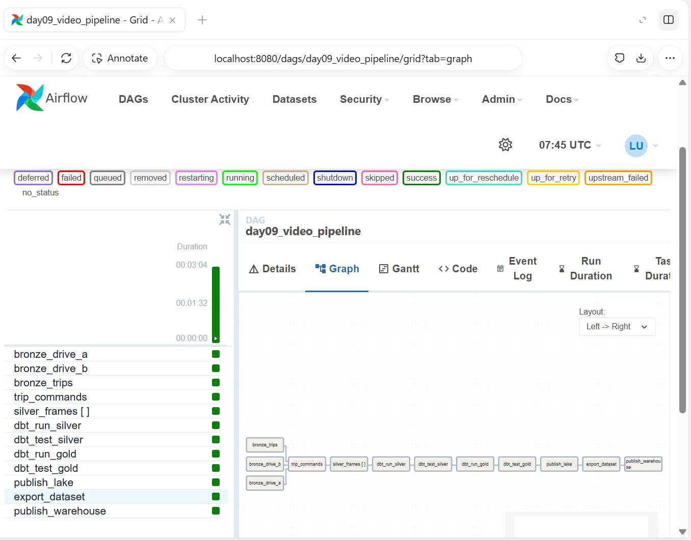
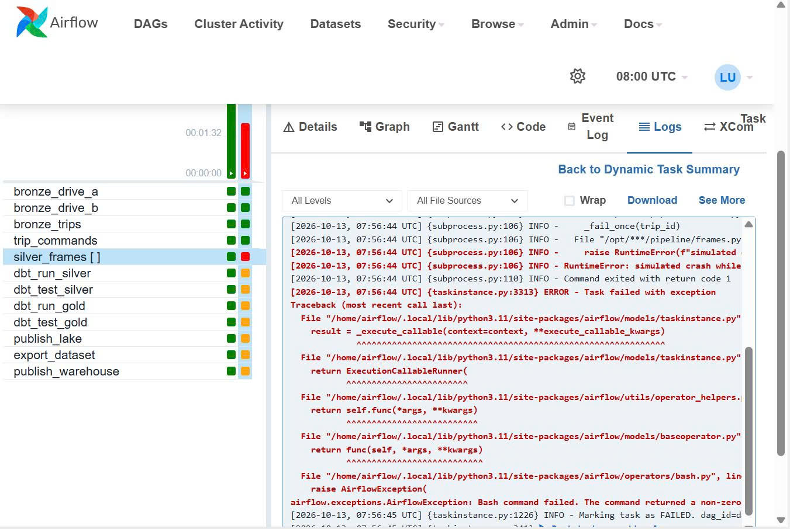
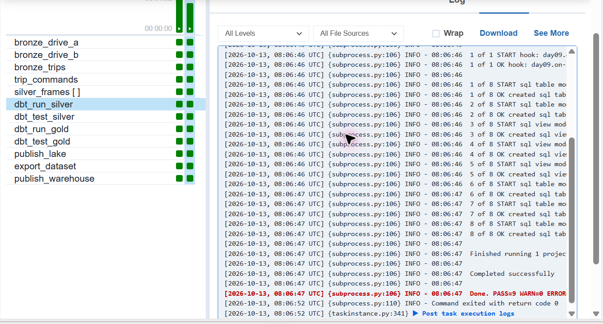
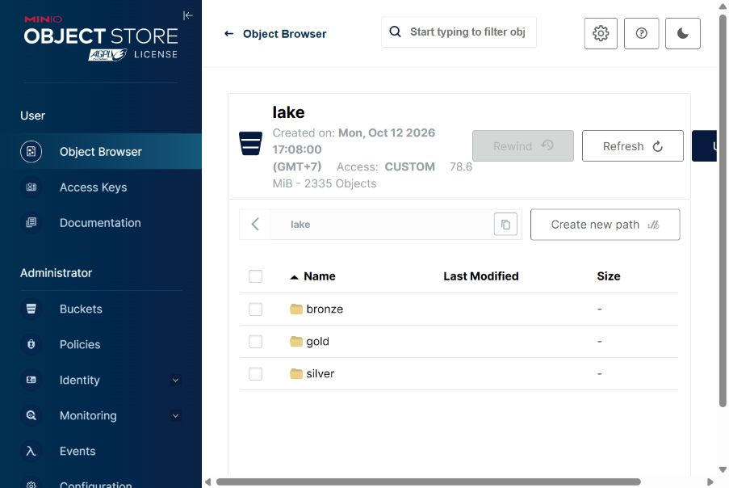
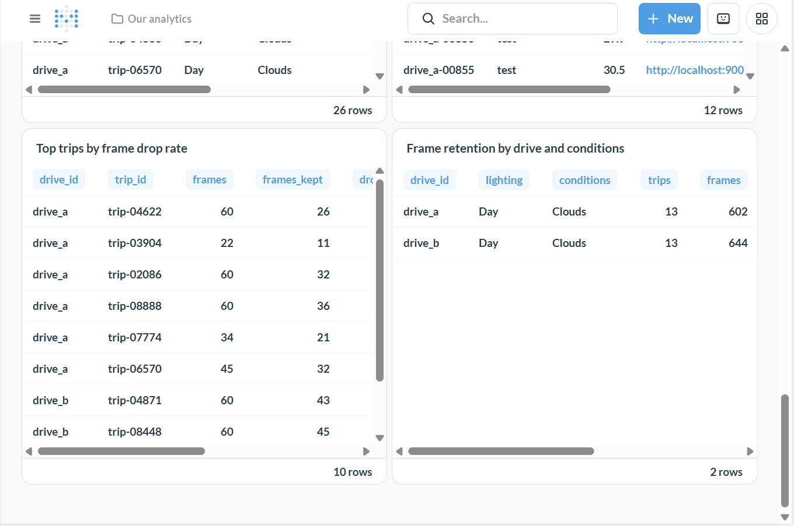

# REPORT — Lab Day 9

| | |
|---|---|
| Họ và tên | Lê Nguyễn Trâm Anh |
| MSSV (đúng bằng `LAB_STUDENT_ID` trong `.env`) | `2A202602760` |
| GitHub | `itskathy05` |
| Trip dùng cho bài tập sập và chạy lại (xem GUIDE, bước 5) | `trip-08448` |

## Tóm tắt kết quả

| Hạng mục | Kết quả |
|---|---:|
| `dataset_version` | `b83bf1f34f4b` |
| Gold frames | 1.019 |
| Train / val / test | 687 / 175 / 157 |
| Trips train / val / test | 18 / 4 / 4 |
| Verify sau retry | 27/27 checks passed |
| DAG `day09_video_pipeline` | Xanh toàn bộ sau khi clear task lỗi và chạy lại |

`dataset_version` của bạn: `b83bf1f34f4b`.

Bằng chứng được lưu trong `report/evidence/` và `report/screenshots/`. Các số liệu dưới đây lấy từ lần chạy gắn với MSSV của tôi; `run_summary.json` ghi cùng student ID, version và số frame như phần tóm tắt.

## Bước 1 · Bronze

### Câu 1

| Thuộc tính | Nguồn A | Nguồn B |
|---|---|---|
| Thời gian | `ts_utc`, chuỗi ISO UTC | `timestamp_ms`, epoch millisecond |
| Tốc độ | `speed_mps`, m/s | `spd_kmh`, km/h |
| Hướng | `heading_deg` | `hdg` |
| Tọa độ | `lat`, `lon` | `latitude`, `longitude` |
| Pedal | `gas`, `brake` theo tỷ lệ | `throttle_pct`, `brake_pct` theo phần trăm |

Ngoài khác biệt schema và đơn vị, đồng hồ nguồn B chạy nhanh hơn video 1.500 ms. Tôi giữ hai nguồn trong các bảng bronze riêng và bảo toàn giá trị gốc để truy vết bản ghi về đúng nguồn, kiểm tra schema, rồi chạy lại chuẩn hóa nếu phát hiện quy tắc chuyển đổi chưa đúng. Ép kiểu và gộp quá sớm sẽ làm mất dấu vết về cách dữ liệu được ghi ban đầu.

## Bước 2 · Silver telemetry

### Câu 2

Nguồn A đã có tốc độ m/s và timestamp ISO nên được chuẩn hóa sang `timestamptz`. Với nguồn B, pipeline đổi km/h sang m/s, epoch millisecond sang UTC và trừ độ lệch đồng hồ 1.500 ms. Sau hiệu chỉnh, bản ghi đầu B là `2025-10-08 14:30:00.009 UTC`, lệch dưới 0,5 giây so với mốc đầu video.

| Drive | Nhận vào | Duplicate | Thiếu tốc độ | Tốc độ ngoài miền | Cách ly | Còn sạch |
|---|---:|---:|---:|---:|---:|---:|
| A | 3.021 | 20 | 30 | 3 | 53 | 2.968 |
| B | 3.234 | 20 | 30 | 3 | 53 | 3.181 |

Với mỗi drive, số dòng sạch cộng số dòng cách ly bằng số dòng nhận vào. Quarantine lưu cả lý do loại để kiểm toán và sửa quy tắc; xóa thẳng các dòng lỗi sẽ làm mất khả năng giải thích vì sao chúng không đi tiếp xuống silver.

### Câu 3

`max_gap_ms` là `warn` vì khoảng trống cảm biến cần được nhìn thấy nhưng không nhất thiết làm dừng pipeline; `in_range` là `error` vì tốc độ ngoài miền hợp lệ làm hỏng dữ liệu downstream.
Trong `break_gate.json`, tôi nới giới hạn tốc độ lên 1.000 m/s. Test `in_range_silver_telemetry_speed_mps__70__0` bắt được 6 dòng không hợp lệ; kết quả là `PASS=5 WARN=1 ERROR=1 SKIP=0` và gate thất bại. Khôi phục cấu hình gốc cho `PASS=6 WARN=1 ERROR=0 SKIP=0`. Thí nghiệm cho thấy gate vẫn cho phép cảnh báo về độ phủ, nhưng chặn dữ liệu vượt kiểm tra nghiêm trọng.

## Bước 3 · Silver frames

### Câu 4

Trong `idempotency.json`, bảng có 1.246 dòng trước và sau hai lần chạy lại; fingerprint vẫn là `6c7480dfde7e`. Thí nghiệm idempotency dùng `trip-00003` với 60 frame: biến thể append hai lần tạo 120 dòng, tức ghi trùng toàn bộ trip. Đây là trip của thí nghiệm ghi dữ liệu; bài tập cố ý làm task lỗi ở bước 5 dùng trip riêng là `trip-08448`.

Overwrite có predicate theo `trip_id` thay phần dữ liệu thuộc đúng trip, nên chạy lại không cộng bản sao và không cần xóa toàn bộ bảng. Kết quả ổn định cả về số dòng lẫn fingerprint là bằng chứng cho tính idempotent của cách ghi đang dùng.

### Câu 5

Khung đen gần như không có thông tin hình ảnh nên bị loại; khung tối có thể là cảnh đêm, đường hầm hoặc bóng râm nên được gắn cờ và vẫn giữ nếu đạt các tiêu chí khác.
Kết quả `run_summary.json` ghi số khung đen A/B là 6/4, khung mờ là 9/0, và khung tối được giữ là 4/61.

Thí nghiệm dHash trong `threshold.json` cho thấy tăng ngưỡng làm tăng số frame bị xem là gần trùng. Ở ngưỡng 2, A có 149 và B có 53 frame gần trùng; tôi giữ ngưỡng này theo cấu hình lab để cân bằng giữa loại cảnh lặp và giữ dữ liệu hữu ích. Ngưỡng cao hơn có thể loại nhầm các cảnh chỉ gần giống nhau. Xe chạy chậm hoặc camera đứng hình thường tạo nhiều frame liên tiếp giống nhau hơn, nên kết quả gần trùng cũng cần được đọc cùng bối cảnh tốc độ.

| dHash khác tối đa | số khung trùng, drive A | số khung trùng, drive B |
|---|---:|---:|
| 0 | 61 | 8 |
| 2 | 149 | 53 |
| 6 | 363 | 244 |

## Bước 4 · Gold

### Câu 6

`leakage.json` có 1019 frame thuộc 26 trip. Chia ngẫu nhiên theo frame làm cả 26 trip xuất hiện ở nhiều split và cả 26 trip có frame ở cả train lẫn test.
Chia theo trip cho 0 trip bị tách. Các frame liền nhau trong cùng cảnh thường rất giống nhau, nên để một số vào train và số khác vào test làm mô hình gần như đã thấy cảnh kiểm thử.
Vì vậy điểm test theo frame có thể đẹp giả tạo và không phản ánh khả năng tổng quát hoá sang chuyến đi mới.

### Câu 7

`dataset_version` là 12 ký tự đầu của SHA256 tính từ danh sách frame ID và split, nên nhận diện nội dung dataset thay vì thời điểm chạy hay số lần chạy.
Xuất lại cùng nội dung cho cùng version `b83bf1f34f4b`; đổi MSSV làm thay đổi thứ tự xếp trip vào split, do đó hash và version thay đổi.
Manifest hiện tại ghi 1019 frame: train 687, val 175, test 157; 18 / 4 / 4 trip tương ứng.

### Câu 8

Manifest `gold/datasets/b83bf1f34f4b/manifest.json` lưu lineage cùng hash nguồn. Các số như `bronze.raw_telemetry_a=0`, `silver.frames=25` là **version Delta của bảng tại thời điểm đọc**, không phải số dòng. Manifest ghi `bronze.video_files=1`; hash video A là `636ba1a98dfc5ba665d1c935e1d2064e69f4df360ff9ffbd15795957d5e7e9aa`, video B là `bfa62703f645ff77a8578ae3fc74a00881140d38a404d43c8e2af265bbee9fdc`.

Kết hợp version bảng, hash video, quy tắc lọc và quy tắc split, lineage cho phép xác định chính xác dataset được tạo từ snapshot nào và hỗ trợ tái tạo hoặc điều tra sai lệch về sau.

## Bước 5 · Điều phối và phục vụ

### Câu 9

Lần chạy `07:55 UTC` có đúng một mapped task `silver_frames` đỏ: map index 22, trip `trip-08448`; bảy task phía sau chuyển `upstream_failed`.
Task lỗi được clear riêng, lần thử thứ hai xanh. Vì các task downstream vẫn cam sau đó, tôi clear `dbt_run_silver` để chạy tiếp chuỗi downstream; cuối cùng toàn bộ DAG xanh.
Manifest sau orchestration vẫn version `b83bf1f34f4b` và 1019 frame, không nhân đôi partition. Verify cuối sau retry đạt `27/27 checks passed` và đã lưu trong `report/verify.txt`.

### Câu 10

Ở quy mô 500 xe/ngày, bước trích frame sẽ nghẽn trước vì mỗi trip chạy tuần tự (`max_active_tis_per_dagrun=1`); tôi sẽ dùng worker pool phân tán, giới hạn song song và hàng đợi có backpressure.
Tiếp theo, nạp file và MinIO đơn máy sẽ thành điểm nghẽn; thay bằng object storage phân tán, ingestion theo sự kiện và partition theo ngày/xe.
DuckDB và Postgres đơn node cũng không phù hợp cho nhiều consumer/khối lượng lớn; chuyển xử lý sang Spark hoặc engine lakehouse phân tán và phục vụ analytics bằng warehouse mở rộng ngang, như nội dung slide 12, 22, 23.

## Câu hỏi riêng của bạn trên Metabase

```sql
select drive_id, trip_id, frames, frames_kept,
       round(100.0 * (frames - frames_kept) / nullif(frames, 0), 1) as drop_pct,
       avg_speed_kmh, lighting, conditions
from marts.mart_trip_summary
order by drop_pct desc, drive_id, trip_id
limit 10;
```

Câu hỏi `Top trips by frame drop rate` xếp `drive_a / trip-04622` cao nhất trong kết quả: giữ 26/60 frame, tỷ lệ loại 56,7%. Đây là tín hiệu để nhóm vận hành ưu tiên kiểm tra trip có chất lượng video thấp hoặc có nhiều cảnh gần trùng; tỷ lệ loại cao tự nó chưa xác định nguyên nhân.

## Câu hỏi Metabase bonus thứ hai

Trong dashboard, cả hai hàng có điều kiện Day/Clouds: A có 13 trip, 602 frame và giữ 436 (loại 27,6%); B có 13 trip, 644 frame và giữ 583 (loại 9,5%). Chênh lệch cho thấy drive A đáng được rà soát thêm về chất lượng video và các quy tắc lọc; đây là hướng điều tra, không phải kết luận rằng drive A chắc chắn có lỗi.

SQL:

```sql
select drive_id, lighting, conditions, count(*) as trips,
       sum(frames) as frames, sum(frames_kept) as frames_kept,
       round(100.0 * sum(frames - frames_kept) / nullif(sum(frames), 0), 1) as drop_pct,
       round(avg(avg_speed_kmh)::numeric, 1) as avg_speed_kmh
from marts.mart_trip_summary
group by drive_id, lighting, conditions
order by drop_pct desc, trips desc
limit 20;
```

## Thí nghiệm bonus · Sync tolerance

Dùng ngưỡng mặc định 150 ms làm baseline: 7 frame mất đồng bộ mỗi drive và 1019 Gold frame. Tôi áp dụng đúng predicate `sync_gap_ms <= 50` của model lên snapshot Delta `silver.frame_telemetry` đã lưu (1246 frame), cùng các bộ lọc Gold.
Ở 50 ms, frame mất đồng bộ tăng thành A 272, B 328; Gold còn A 242, B 296, tổng 538. Như vậy giảm 481 frame, tức 47,2% so với baseline.
Ngưỡng thấp đòi hỏi ghép thời gian chặt hơn nhưng làm giảm mạnh lượng dữ liệu huấn luyện. Phép tính dùng snapshot và predicate thực tế; model cuối vẫn ở cấu hình 150 ms.

## Ảnh bằng chứng











## Nhìn lại

Điều làm tôi chú ý nhất là chia theo frame khiến cả 26 trip cùng rò rỉ giữa train và test, còn chia theo trip đưa số trip bị tách về 0. Phân tích sync tolerance cũng cho thấy chỉ đổi ngưỡng từ 150 ms xuống 50 ms đã làm Gold giảm 47,2%, nên ngưỡng đồng bộ là quyết định ảnh hưởng trực tiếp đến quy mô tập huấn luyện.

Một trường hợp tôi chưa thấy pipeline kiểm tra là tọa độ GPS hợp lệ về kiểu và miền nhưng nhảy đến vị trí bất khả thi giữa hai timestamp. Bước tiếp theo tôi đề xuất là tính tốc độ suy ra từ khoảng cách GPS và thời gian, rồi quarantine các đoạn vượt ngưỡng vật lý có thể giải thích được.
